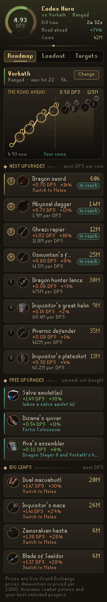
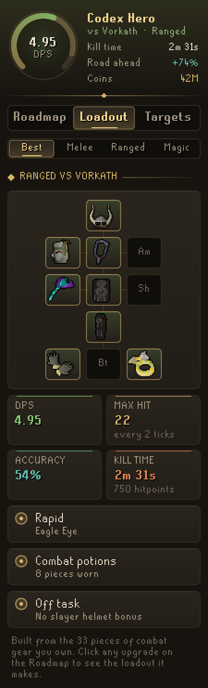
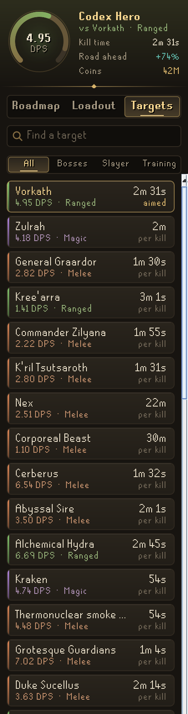
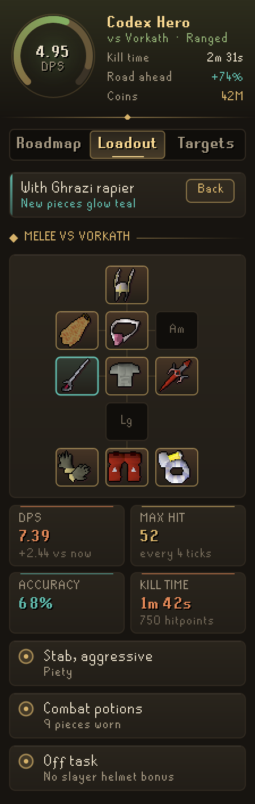
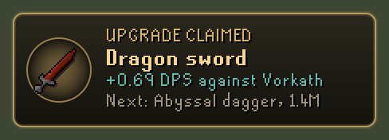
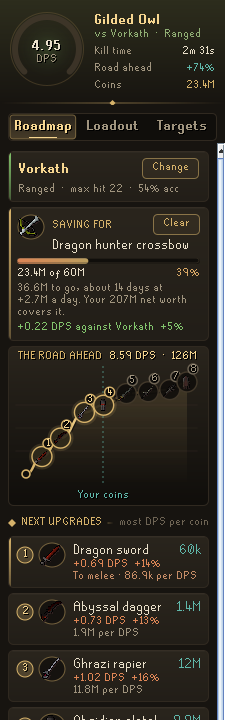
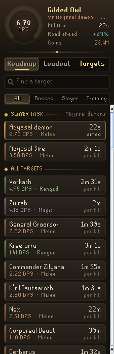

# Codex Gear Roadmap

**Your next gear upgrades, ranked by damage per coin.** Codex Gear Roadmap reads the gear you own and your real levels, works out your best loadout against the monster you are aiming at, and lays out the road ahead: which upgrade adds the most damage for every coin, then the next one from there, until your loadout is close to the best in slot.

It is the fourth plugin in the **Codex** suite, after [Codex Navigator](https://github.com/Nubles/OSRS-Codex-Navigator), [Codex Guardian](https://github.com/Nubles/OSRS-Codex-Guardian) and [Codex Log Insight](https://github.com/Nubles/OSRS-Codex-Log-Insight), and shares their look: warm ink, aged gold and the game's own fonts.

<p align="center">
  
  
  
</p>

## What it does

- **Roadmap.** A dial with your damage per second now, then the road ahead as a chart: each upgrade is a stop, the stretch your coins already cover is lit, and the rest waits further on. Below it, the next upgrades in order with their price, the damage each adds, what each point of damage costs and whether you can afford it yet. Upgrades you earn rather than buy (a Salve amulet imbue, Dizana's quiver, the void sets), the biggest leaps off the cheap road, and upgrades you could use after some training get their own lists.
- **Loadout.** The best loadout from what you own, laid out like the equipment screen, with its damage per second, max hit, accuracy, kill time, attack style and prayer. Switch between your best melee, ranged and magic setups, or click any upgrade on the Roadmap to see the loadout it builds, with the new pieces glowing.
- **Targets.** Over 70 bosses, slayer monsters and training spots with your damage and kill time against each. Click one to aim your roadmap at it.
- **Savings goal.** Click any upgrade you would buy and press **Save for it**. The Roadmap tab then shows how far your coins go toward it, and, if you also use [Codex Ledger](https://github.com/Nubles/OSRS-Codex-Ledger), roughly how many days the rest should take at the pace your net worth grew over the last week. A plaque and a chat line tell you when your coins cover it, and again when it is yours.
- **Follows your slayer task.** While your task is for a monster on the Targets list, the roadmap aims at it, so the road answers "what should I buy for this task?". The Targets tab lists the task's monsters first. Bosses a broad task also covers, such as Callisto on a bears task, are listed there rather than aimed at. Pick any other target and the roadmap stays on it until your next task; the **Follow slayer task** setting turns this off.
- **Where you fight.** If you use [Codex Session Chronicle](https://github.com/Nubles/OSRS-Codex-Session-Chronicle), the Targets tab reads the kills it logged over the last 30 days and names the buys that would save you the most time across the monsters you actually fight, weighted by how often you fight them, with the time each would have saved you over those days.
- **Levels that pay.** The Loadout tab lists the next Strength, Attack, Ranged or Magic level that would raise your damage in the gear you already wear, with the new max hit and what the road ahead would charge in coins for the same extra damage.
- **Upgrade plaque.** When you get an upgrade from your road, a gilt plaque shows the damage it adds and what is next. A matching line can go to the chat box too.

<p align="center">
  
  
</p>

<p align="center">
  
  
</p>

## Getting started

Open your bank once so Gear Roadmap knows everything you own. Your worn gear and inventory are read as they change, and the bank is remembered per account. Coins moving in and out only move the "in reach" line, and experience drops do nothing until you gain a level, so the plan is not redone while you fight. Pick a target on the Targets tab, or type one in the plugin's settings.

## How the numbers work

- **Damage** follows the game's formulas as the OSRS Wiki documents them: accuracy and max hit from your levels, potions, prayers and gear, with the special effects that matter for upgrades, such as the Salve amulet (which never stacks with the slayer helmet), slayer helmet and black mask, void and elite void, crystal armour, Inquisitor's, the obsidian set, the twisted bow, the Tumeken's shadow, Osmumten's fang, the scythe, the dual macuahuitl, keris, dragon hunter weapons (which add to the imbued slayer helmet rather than multiply it), demonbane weapons, revenant weapons in the Wilderness, Dizana's quiver, the tome of fire, enchanted bolts (with the Kandarin hard diary), ice spells with no element, and elemental weaknesses. Monsters with their own rules are handled too: Zulrah's damage cap, the Kraken's ranged resistance, the Corporeal Beast's halved damage and the tormented demon's shield.
- **Checked against the wiki.** The tests compare the engine with the wiki's DPS calculator on a fixed set of loadouts, and it agrees to within 1% on thousands of random ones. Where Gear Roadmap knowingly differs it says why: Vardorvis uses his mid-fight Defence, ruby bolts are averaged over the whole kill, the Soulreaper axe assumes five stacks and the blowpipe assumes dragon darts. Vorkath's melee damage counts at 80%, because his acid phase and fire bombs keep a melee player walking while ranged and magic keep attacking; the Loadout tab says so when it applies.
- **Your best loadout** is searched for each of melee, ranged and magic from everything you own, then the best of the three is used.
- **Kill time.** Each upgrade's tooltip gives the kill time before and after it.
- **The road** picks the upgrade with the most damage gained per coin, adds it to your gear, searches again and repeats, so each step is weighed against the loadout the steps before it built. Two pieces that each fall just short of the next max hit, but cross it together, are offered as one step. Prices are live Grand Exchange prices from RuneLite (platinum tokens count as coins), and ammunition is priced per 1,000. The road starts from iron scimitars and shortbows, so new accounts get one too.
- **Ironmen** cannot buy, so their road shows its total cost instead of their coins, and prices stand for how hard each item is to get. Seasonal worlds are planned without their relics, and the panel says so.
- **Assumptions** are in the settings: combat potions or none, and offensive prayers you have unlocked (Piety, Rigour, Augury, Deadeye and Mystic Vigour are read from the game). The **Slayer helmet bonus** setting counts the black mask and slayer helmet against Slayer monsters and against whatever your current task covers, boss tasks included; it can also be set to always or never. The Loadout tab shows which was assumed.

## Rules posture

Gear Roadmap only reads what the game already shows you: your equipment, inventory, bank, levels and prayer unlocks. With Codex Ledger installed it also reads, and never writes, the net worth history Ledger saves in your RuneLite profile, and with Codex Session Chronicle installed it reads, and never writes, the kills Chronicle logged; without them, everything else works the same. It does not click, change menus, send chat or touch the network beyond RuneLite's own price lookups. Your bank is saved per account in your RuneLite profile and never leaves your computer.

## Credits

Item and monster stats come from the [Old School RuneScape Wiki](https://oldschool.runescape.wiki) (CC BY-NC-SA 3.0), by way of the wiki's [DPS calculator](https://github.com/weirdgloop/osrs-dps-calc). See [THIRD_PARTY_NOTICES.md](THIRD_PARTY_NOTICES.md).

## Development

```bash
./gradlew build   # compile and run tests
./gradlew run     # launch RuneLite with the plugin loaded
python3 tools/build_data.py <osrs-dps-calc checkout> src/main/resources/com/codex/gearroadmap/gear-roadmap.json   # rebuild the data
```
