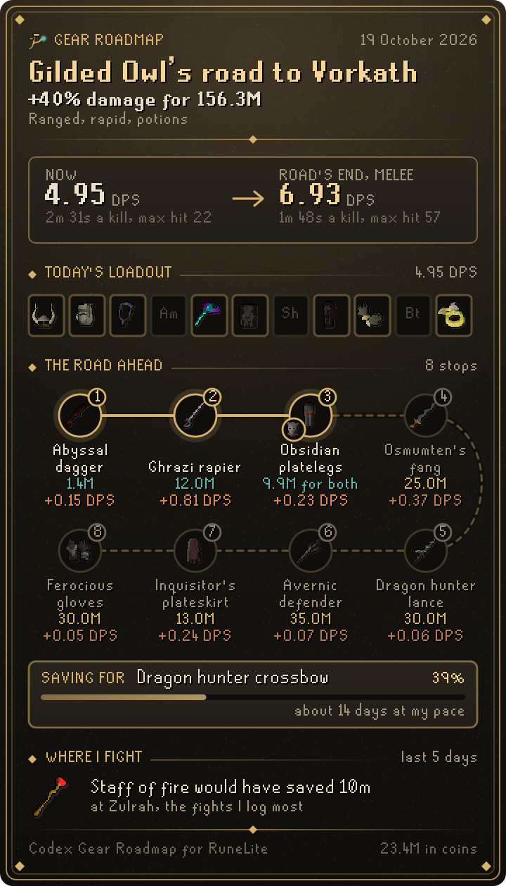

# Codex Gear Roadmap

**Your next gear upgrades, ranked by damage per coin.** Codex Gear Roadmap reads the gear you own and your real levels, works out your best loadout against the monster you are aiming at, and lays out the road ahead: which upgrade adds the most damage for every coin, then the next one from there, until your loadout is close to the best in slot.

It is part of the **Codex** suite and shares its look: warm ink, aged gold and the game's own fonts.

<p align="center">
  
  
  
</p>

## What you get

- **Roadmap.** Your damage per second now, then the road ahead as a chart, lit as far as your coins reach. Below it, the next upgrades in order with their price, the damage each adds and what each point of damage costs. Upgrades you earn rather than buy (a Salve amulet imbue, Dizana's quiver, the void sets) and the biggest leaps off the cheap road get their own lists.
- **Savings goal.** Press **Save for it** on any upgrade and the Roadmap tab shows how far your coins go toward it. A plaque and a chat line tell you when your coins cover it, and again when it is yours.
- **Road behind.** Each upgrade you pick up from the road is kept with the damage it added, where and the day.
- **Outgrown.** Combat gear you own that none of your best loadouts wear, with what it would sell for (not shown to ironmen).
- **Loadout.** The best loadout from what you own, laid out like the equipment screen, with its damage, max hit, accuracy and kill time, for melee, ranged and magic. It lists what to put on from your inventory or bank, and the next level that would raise your damage.
- **Targets.** Over 70 bosses, slayer monsters and training spots with your damage and kill time against each. Click one to aim the road at it. While your slayer task covers a listed monster, the road follows the task.
- **Road card.** **Save card** or **Copy** turns your road into a card to share: your loadout, every stop on the road with its price and damage, and your savings goal.
- **Upgrade plaque.** When you get an upgrade from your road, a plaque in the game view shows the damage it adds and what is next.

<p align="center">
  
</p>

## Getting started

Open your bank once so Gear Roadmap knows everything you own (or let it read Codex Bank Steward's saved bank, below). Then pick a target on the Targets tab. Your worn gear and inventory are read as they change, and the bank is remembered per account.

## Settings that matter

| Setting | What it does |
| --- | --- |
| Target | The monster the road is for; easiest picked on the Targets tab. |
| Potions, Offensive prayers | What the damage figures assume you use. |
| Slayer helmet bonus | When the black mask and slayer helmet bonus counts: by default against Slayer monsters, and against a boss only while your task covers it. |
| Follow slayer task | Aim the road at your slayer task's monster while you have one. On by default. |
| Upgrade plaque, Plaque time, Upgrade in chat | How a claimed upgrade or an affordable savings goal is announced. |
| Name on cards | Writes your character's name on the road card. On by default. |
| Worth on cards | Shows your coins and how far they go toward your goal on the road card. Off by default. |

## With other Codex plugins

Gear Roadmap works on its own. If you also use these, it reads (never writes) what they save:

- **[Codex Ledger](https://github.com/Nubles/OSRS-Codex-Ledger)**: your net worth history, so the savings goal says roughly how many days the rest should take at last week's pace.
- **[Codex Session Chronicle](https://github.com/Nubles/OSRS-Codex-Session-Chronicle)**: the kills it logged over the last 30 days, so the Targets tab can name the buy that would have saved you the most time where you actually fight.
- **[Codex Bank Steward](https://github.com/Nubles/OSRS-Codex-Bank-Steward)**: its saved copy of your bank, so there is no need to open the bank first.

Codex Quartermaster, Plunder Pilot and Pest Control Pilot read the gear bank this plugin saves, and Codex Bank Steward reads its savings goal.

## How the numbers work

Damage follows the game's formulas as the OSRS Wiki documents them, including the special effects that matter for upgrades (Salve amulet, slayer helmet, void, crystal armour, the twisted bow, dragon hunter and demonbane weapons, enchanted bolts and more) and monsters with their own rules (Zulrah's damage cap, the Corporeal Beast, tormented demons). The tests check the engine against the wiki's DPS calculator. The road picks the upgrade with the most damage per coin, adds it, and searches again, so each step is weighed against the gear the steps before it built. Prices are RuneLite's live Grand Exchange prices; ironmen see a total cost instead of their coins.

Saves damaged in part keep everything that can still be read, and a road behind or savings goal that could not be read whole (or holds a later version's fields) is first copied aside, one copy each, so the next save never writes over the only copy.

## Rules posture

Gear Roadmap only reads what the game already shows you: your equipment, inventory, bank, levels and prayer unlocks. It does not click, change menus, send chat or touch the network beyond RuneLite's own price lookups. A road card is only written when you press Save and pick where it goes.

## Credits

Item and monster stats come from the [Old School RuneScape Wiki](https://oldschool.runescape.wiki) (CC BY-NC-SA 3.0), by way of the wiki's [DPS calculator](https://github.com/weirdgloop/osrs-dps-calc). See [THIRD_PARTY_NOTICES.md](THIRD_PARTY_NOTICES.md).

## Development

```bash
./gradlew build   # compile and run tests
./gradlew run     # launch RuneLite with the plugin loaded
python3 tools/build_data.py <osrs-dps-calc checkout> src/main/resources/com/codex/gearroadmap/gear-roadmap.json   # rebuild the data
```
